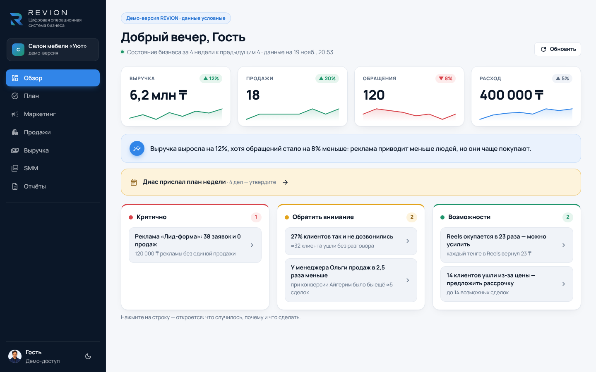
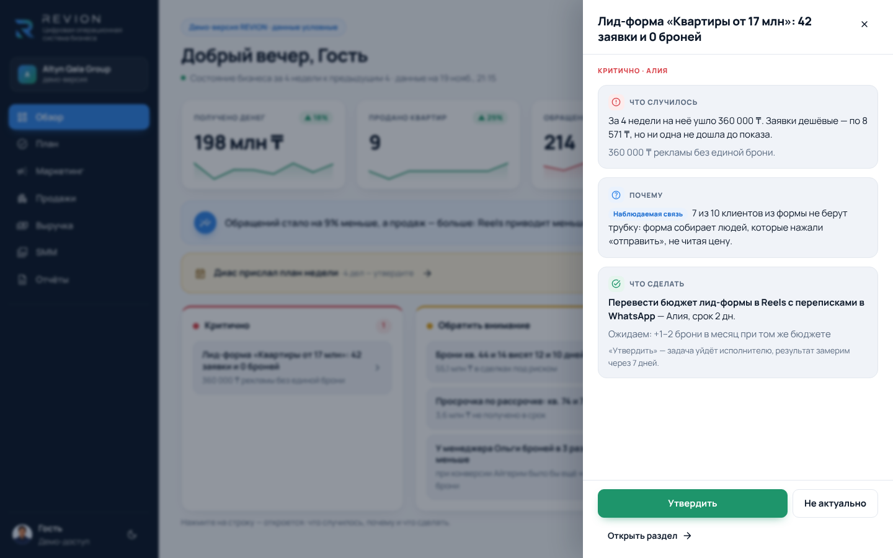
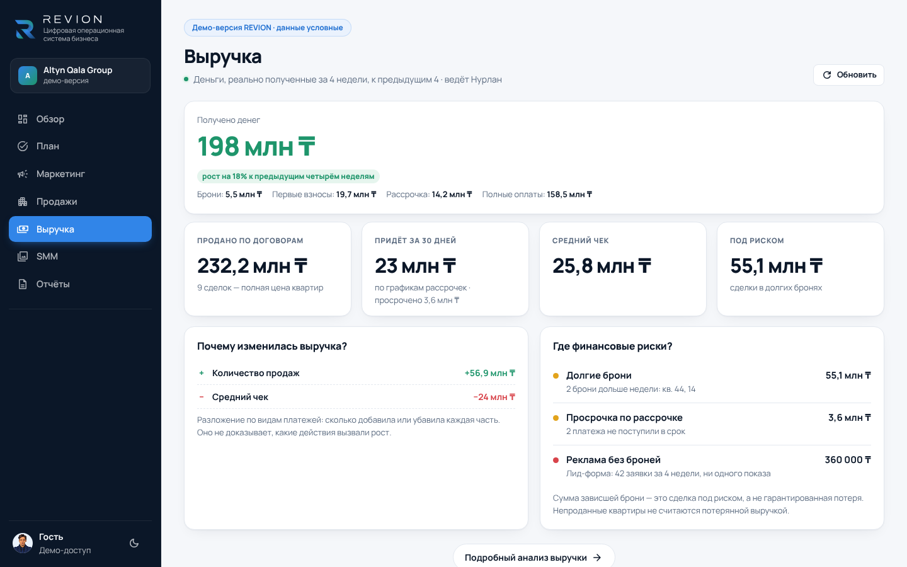
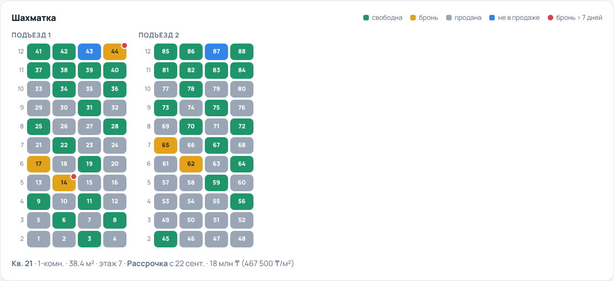
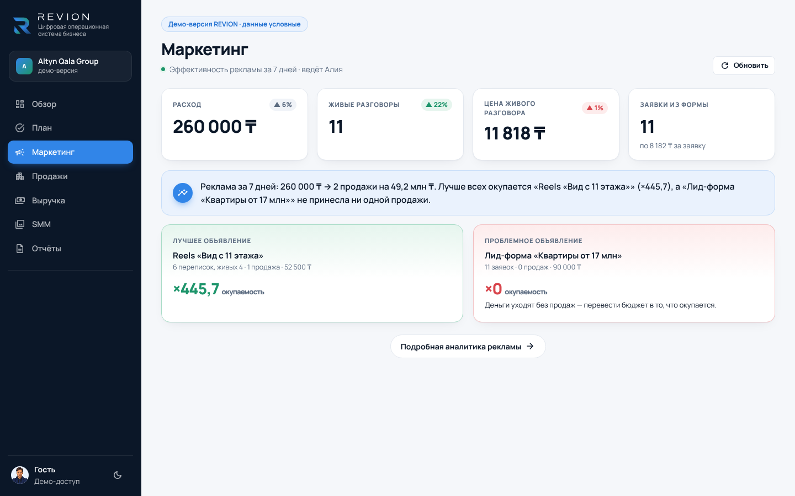
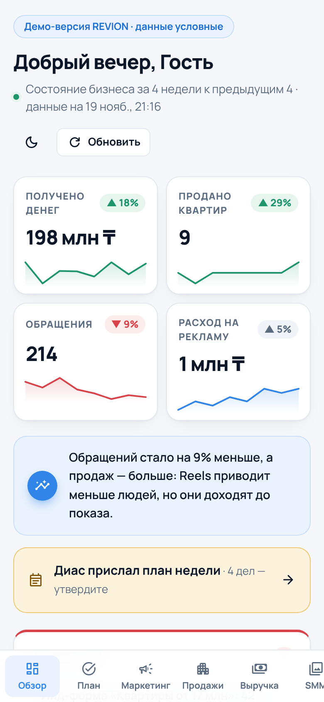

# REVION — an AI office that runs a sales & marketing department

REVION is a "virtual office" of six AI employees built on **Claude Code**. It runs 24/7 on a small cloud server and does the analytical and content work for a residential real-estate developer in Kazakhstan: it reads ad performance, the apartment sales chart, CRM leads and Instagram stats, writes weekly and monthly reports, proposes actions, and produces and publishes the company's Instagram content.

The owner talks to it like to a team lead: send a task in Telegram → the manager agent returns a structured plan → the owner taps **Approve** → specialist agents do the work and send back files, images, videos and reports.

> **This is the full source of the production system.** Only things that identify the real company and people were replaced: the company and project names are now the fictional **Altyn Qala Group**, server address, phone numbers, account IDs, an employee's name and the company's prices are placeholders. All integrations (Claude Code, Telegram, Meta Ads, Instagram publishing, CRM, sales-chart API) are the real code. Company data, tokens and the knowledge base were never in git (`data/`, `knowledge/` are ignored). The web portal also runs on **made-up demo data** for a fictional residential developer with one command — see below.



---

## What it does

| Agent | Role |
|---|---|
| **Manager** | Turns a free-text request into a JSON plan (steps, assignees, dependencies, inputs). Writes the Monday weekly report and the monthly report, answers questions about past work. |
| **Marketing analyst** | Analyses Meta Ads + Instagram. Keeps a full archive of every ad since 2023, makes forecasts that the office later checks against reality automatically. Watches ads every 3 hours and writes a ready conclusion ("I looked at it… I recommend turning it off"). Sees who *really* talks to sales (age, gender, region and hour of the conversations that went past 3 messages, not of all clicks), what each Instagram promotion costs per new follower, which placement and which video hook sell. Builds the weekly content plan **from a sales brief computed by code** — every post must name what it sells, to whom, and cite numbered facts. |
| **Sales analyst** | Apartment sales chart, bookings, stalled deals, CRM funnel, refusal reasons, call scripts. |
| **Revenue analyst** | Money actually received (bookings, down payments, installment payments), sales pace vs. the building's handover date, monthly goals. |
| **SMM** | Posts, carousels and stories as finished images in the brand style (HTML → Chrome render), then turned into 15-second motion-graphics videos with music, and **auto-published** to Instagram on schedule after one weekly approval. The approval screen shows the week's strategy and, for every post, the product, USP, audience and the numbers behind the choice. |
| **Video editor** | Cuts 15-second Reels from raw construction-site footage (agent picks moments from storyboards, ffmpeg does the cut). |

Everything that leaves the company (posts, messages, spending) needs an explicit owner approval. Agents prepare drafts; humans decide.

**Scheduled, without anyone asking:** ad and sales "watchdogs" every 3 hours, a 9:00 morning line in Telegram ("all calm" or up to three things to do today), the Monday weekly report (message + 1-page PDF), the monthly report on the 1st (4-page PDF + Excel), the Thursday content package, automatic "did it work?" measurements 7 days after every completed task, and alerts when a data source goes stale.

---

## Architecture

```mermaid
flowchart LR
  TG[Telegram bot] --> D[Dispatcher / queue]
  P[Web portal] --> D
  W[Schedulers & watchdogs] --> D
  D -->|plan request + JSON schema| M[Manager agent]
  M -->|plan| O{Owner approves}
  O --> D
  D -->|isolated task folder| A[Specialist agents<br/>claude -p, one run per task]
  subgraph Data pulled before each run, by code
    S1[Meta Ads & Instagram Graph API]
    S2[Sales-chart portal API]
    S3[CRM API, read-only]
    S4[National Bank FX rate]
  end
  S1 & S2 & S3 & S4 --> D
  A --> R[Results: text, images, PDF, Excel, video]
  R --> TG
  R --> P
  R --> IG[Instagram publishing API]
```

- **Node.js, zero npm dependencies** — only built-in modules (`http`, `child_process`, `crypto`, …). ~12.6k lines across 44 server modules, plus ~5k lines of front end. PDFs and images are rendered with headless Chrome over the DevTools pipe, video with ffmpeg, Excel files are written by hand (`xlsx.js`, no library).
- **Each AI employee is a short-lived `claude -p` process**, started for one task and closed afterwards — the office costs nothing while idle. See [`server/claude.js`](server/claude.js).
- **Code does the math, the model writes the words.** All numbers, charts and comparisons in reports are computed deterministically; the model gets the finished numbers and writes the conclusion and 3 recommendations. This made reports both cheaper and impossible to "hallucinate" numbers into.
- **Self-updating server:** a systemd timer checks GitHub every 3 minutes, syntax-checks the new version, waits until no agent is running, swaps the code, and **rolls back automatically** if the office doesn't come up in 20 seconds.

---

## The engineering problems worth talking about

### 1. Running a team of agents on a flat-rate subscription
A naive `claude` launch loads 20–60k tokens of context before doing anything. Each employee is launched with an explicit system prompt, an explicit tool whitelist, no MCP servers, no session persistence, a turn limit and a per-task budget cap:

```
claude -p --output-format stream-json --model M --effort E --system-prompt <role>
  --tools <whitelist> --strict-mcp-config --restricted --no-session-persistence
  --max-turns N --max-budget-usd X [--json-schema <plan schema>]
```

Result: **~860 input tokens** for an empty run, **~$0.005** for a manager plan, a global concurrency limiter shared by every kind of run, and automatic re-queueing when the subscription's 5-hour window is exhausted (read from the `rate_limit_event` in the stream).

### 2. Structured planning with human approval
The manager is forced to answer with a JSON schema whose `employee` field is an `enum` built from the **currently active** employees, with `depends_on` and `inputs` (ids of earlier work whose files get copied into the new task's folder). If the request is a question rather than a task, the manager answers in `reply` and returns no steps. Plans can be approved, edited by replying in Telegram, or rejected.

### 3. Data you can trust
Business numbers came from four systems that disagree with each other. A dedicated audit produced shared rules used by every report: one definition of a "sale" (net of cancellations, a client moving to another apartment is not a new sale, days counted in the Astana timezone), "unknown" instead of a fake 0 when a source is silent, a freshness tracker for every source (the morning line says *"⚠️ CRM hasn't answered since 03:10"* instead of *"all calm"*), CRM sync that refuses to overwrite a good copy with a suspiciously short response, filtering of bot/spam leads (SQL-injection and XSS probes hitting the website form), and closed months that are never rewritten — later corrections are logged as "was → now".

### 4. Privacy by construction
Agents never see client names, phones or national IDs. Exports are anonymised before an agent's folder is created; CRM refusal notes are scrubbed (phones, emails, IDs, links, any capitalised name) **before** they reach the model and are never written to disk — only the model's short paraphrase is stored. `--restricted` confines each agent's file tools to its own task folder (verified: reading `../../data/…` is refused). Rendered HTML gets a `default-src 'none'` CSP so a generated layout cannot call out to the internet.

### 5. Closing the loop
Every completed task is measured 7 days later ("worked / didn't / not enough data") and written into a business memory that the manager reads when planning. Owner corrections (a reply to a result, 👎 with a reason) become rules the employee follows next time. The marketing analyst's forecasts are checked against actual results automatically, and approved images become style references for future posts.

### 6. Content that publishes itself — safely
After one weekly approval (with per-day "fix this day" edits), posts and stories are rendered, converted into 15-second motion videos (layout blocks appear in sequence, prices count up, the last frame is verified to equal the approved image), and published via the official Instagram API at slightly varied times. If the video fails, the approved image goes out instead. An automatic layout check in Chrome catches overlapping text before anything is sent for approval.

### 7. Argued content: every post has to justify itself with numbers
Agents writing marketing copy love to invent plausible statistics. So the weekly content plan starts from a **sales brief built by code** ([`server/content-brief.js`](server/content-brief.js)): numbered facts `Ф1…Фn` — unsold stock and sales pace by apartment type, payments, refusal reasons from the CRM, who writes from ads, the Instagram audience, what content worked before. The marketing agent must return, for each item, `kind` (sell / build trust), `focus` (product, USP, audience or the objection it answers), the fact ids it relies on and a short "why". Then code checks every number in every "why" against the cited facts (`checkPlan`): unknown fact ids are dropped, a "why" with a number that isn't in its facts is replaced by the facts themselves, and the owner sees how many were replaced. The SMM agent gets the focus of each post; the published result is tagged `[sale · USP]`, so next week's brief knows which argument actually worked. No extra model calls — just tighter inputs and a deterministic check.

### 8. Getting more out of the Meta API without guessing
[`server/ads-more.js`](server/ads-more.js) turns the nightly ad archive into answers the owner actually asked for: reach of each promotion as Meta counts it per campaign (reach is never the sum of ads), profile visits and new followers with an explicit **"Meta" vs "estimate"** label when the API doesn't report follows; the age/gender/region portrait of *live* conversations; conversations by hour shifted to local time and compared with the sales manager's working hours; cost per live conversation by placement; video hook rate (3-second views ÷ impressions) and watch-through. Fields that differ between Graph API versions are probed once (`tryField`) and remembered, so a refused field never breaks the nightly run.

---

## The portal

One-page app: **10 seconds** to see the state of the business, **1 minute** to see what matters and what to do, **5 minutes** for full analytics. Every signal opens the same panel — **What happened → Why → What to do** — with one **Approve** button that sends the task to the right agent.

| | |
|---|---|
|  |  |
|  |  |

Login is passwordless via the Telegram bot, with roles (owner / leadership read-only / sales manager) and one-time invite links. Light and dark themes, works on phones.



### Run the demo locally

Requires Node.js 20+. No `npm install` needed.

```bash
node demo/server.js --all
# open http://127.0.0.1:3791
```

The demo serves the real portal front end with made-up data for a fictional residential developer — a 88-flat building with a sales chart, installments, ads and CRM funnel. Buttons only explain what would happen; nothing is sent anywhere.

---

## Code tour

| File | Look at |
|---|---|
| [`server/claude.js`](server/claude.js) | How an AI employee is launched: the economical flag set, a shared concurrency limiter for every kind of run, orphan-process cleanup after a crash, stream-JSON parsing, human-readable failure reasons |
| [`server/office.js`](server/office.js) | The dispatcher. `runPlan()` — manager plan with a JSON schema whose `employee` enum is built from active agents; `prepareWorkspace()` — each task gets an isolated folder with only the data it needs; `reviewDesign()` — layouts are checked in Chrome for overlapping text and sent back to the agent once if broken |
| [`server/employees.js`](server/employees.js), [`employees/`](employees/) | The team: model, effort, turn limit, budget cap and tool whitelist per agent, and each agent's role prompt |
| [`server/initiative.js`](server/initiative.js) | Watchdogs, Monday reports, weekly plan, monthly goals, the "did it work after 7 days" loop, business memory |
| [`server/reports.js`](server/reports.js), [`server/months.js`](server/months.js), [`server/charts.js`](server/charts.js) | Weekly / monthly reports: numbers and SVG charts computed by code, one cheap model run writes the words; PDF + Excel |
| [`server/sales.js`](server/sales.js) | WhatsApp chats and lead tables anonymised before an agent sees them; fails closed on unknown chat formats; raw file deleted. Tests: [`test/anonymize.test.js`](test/anonymize.test.js) |
| [`server/crm.js`](server/crm.js) | Read-only CRM sync: incremental + nightly full pulls, refuses to overwrite a good copy with a suspicious one, spam/attack lead filter, refusal notes anonymised in memory and never written to disk |
| [`server/meta.js`](server/meta.js), [`server/ads-archive.js`](server/ads-archive.js), [`server/ads-rules.js`](server/ads-rules.js) | Meta Marketing / Instagram Graph API, a nightly archive of every ad, forecasts checked against reality |
| [`server/smm-pack.js`](server/smm-pack.js), [`server/motion.js`](server/motion.js), [`server/render.js`](server/render.js) | Weekly content package with one approval, auto-publishing through the official Instagram API; HTML layout → PNG/PDF/15-second video via headless Chrome over the DevTools pipe (no Puppeteer) and ffmpeg, last frame verified against the approved image |
| [`server/learning.js`](server/learning.js), [`server/facts.js`](server/facts.js) | Owner corrections become per-agent rules; every number in a public post must exist in the material the agent was given |
| [`server/sources.js`](server/sources.js), [`server/sales-rules.js`](server/sales-rules.js) | Freshness of every data source; one shared definition of a sale |
| [`server/telegram.js`](server/telegram.js), [`server/auth.js`](server/auth.js) | Telegram bot (tasks, approvals, files, outbox for network failures) and passwordless portal login through the bot |
| [`tools/auto-update.sh`](tools/auto-update.sh), [`tools/watchdog.sh`](tools/watchdog.sh) | Self-update from GitHub with syntax check, wait-for-idle and automatic rollback; restart watchdog |
| [`portal/`](portal/), [`web/`](web/) | The portal (vanilla JS) and the live pixel office |
| [`CLAUDE.md`](CLAUDE.md), [`docs/`](docs/) | The project memory Claude Code works from: rules, architecture, decisions, what is in progress (in Russian) |

```bash
node --test                 # anonymisation tests
node demo/server.js --all   # portal on demo data → http://127.0.0.1:3791
```

To run the office itself you need Claude Code logged in, your own Telegram bot token and, optionally, Meta / CRM / sales-chart credentials — entered in the office settings (⚙), stored in `data/config.json`, never in git. Step-by-step setup (Russian): [`docs/установка.md`](docs/установка.md).

Prompts, UI texts and docs are in Russian — the office works for a Russian-speaking team. Development history (100+ commits, Sep–Nov 2026) lives in the private original; this public copy starts from a single commit because older commits contain company data.

---

## Timeline & stack

Built solo from September to November 2026; in daily production use since October 2026.

### How it was built
I'm a marketer, not a trained software engineer. The whole system was built by pairing with **Claude Code**: a `CLAUDE.md` acts as the project's long-term memory (rules, architecture map, what's in progress, decisions and why), detailed docs live in `docs/` and are updated by Claude at the end of every change, and a weekly scheduled task audits the notes. Claude Code is also the runtime: every AI employee is a `claude -p` process, so the same tool builds the office and works in it.

**Stack:** Node.js 22 (ESM, no dependencies) · Claude Code CLI (Sonnet / Haiku / Opus per task) · Telegram Bot API · Meta Marketing & Instagram Graph APIs · headless Chrome (DevTools protocol) · ffmpeg · Ubuntu 24.04 + systemd + Caddy · Next.js/Supabase sales-chart portal as a data source.

**Author:** Dias Kadyrbekov
